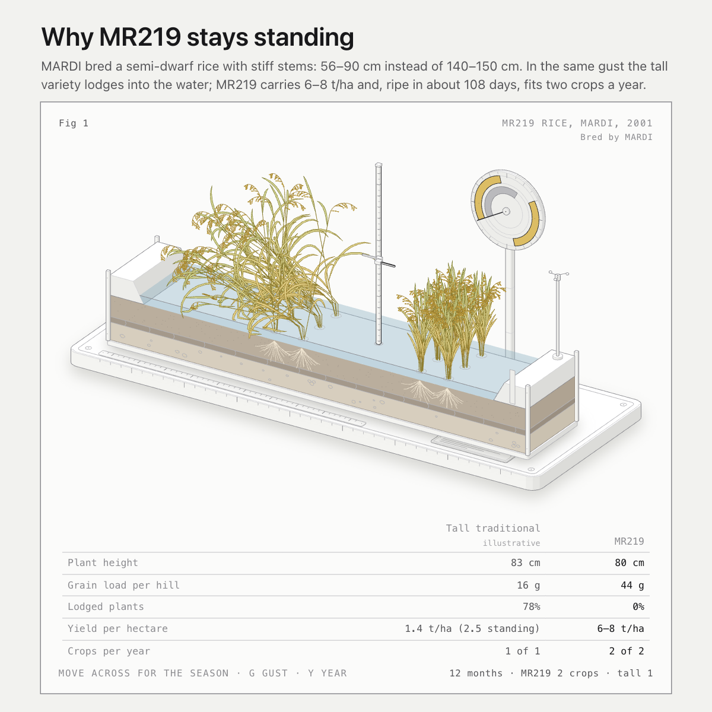

# MR219 rice, MARDI, 2001

An interactive figure explaining why MARDI's semi-dwarf rice variety MR219 was such a step up for Malaysian paddy farmers.

**Open it:** https://jamesbarker185.github.io/mr219-rice/

A cutaway of a flooded paddy plot, drawn to scale (1 unit = 1 cm), with a tall traditional variety beside MR219, a measuring post between them and a crop-calendar wheel behind.

- **Move the pointer across** to run the season from sowing to ripe grain.
- **Click, or press G**, for a gust of wind and rain: the tall row lodges into the water, MR219 sways and stays upright.
- **Press Y** to turn the calendar through a year: two MR219 crops against one tall crop.

MR219: about 56–90 cm tall, 6–8 t/ha, matures in about 105–111 days from sowing. The tall variety's figures (148 cm, 150 days, 2.5 t/ha) and the lodging model are illustrative.

Bred by MARDI.

## Files

- `index.html` – the figure, one self-contained page with no other files needed.
- `preview.png` – the 1200 × 1200 image for social posts.
- `source/` – the build script and model it was made from. They are built with the [Anatomy](https://github.com/wheresryan22/anatomy) figure kit and need it alongside to rebuild.

## Credits

The page includes code from the Anatomy kit, MIT License, Copyright (c) 2026 Ryan.

## Also here

- [`vertical-farm/`](vertical-farm/): a separate figure built the same way, a four-tier vertical farm rack of lettuce under LED light. Open it at https://jamesbarker185.github.io/mr219-rice/vertical-farm/
