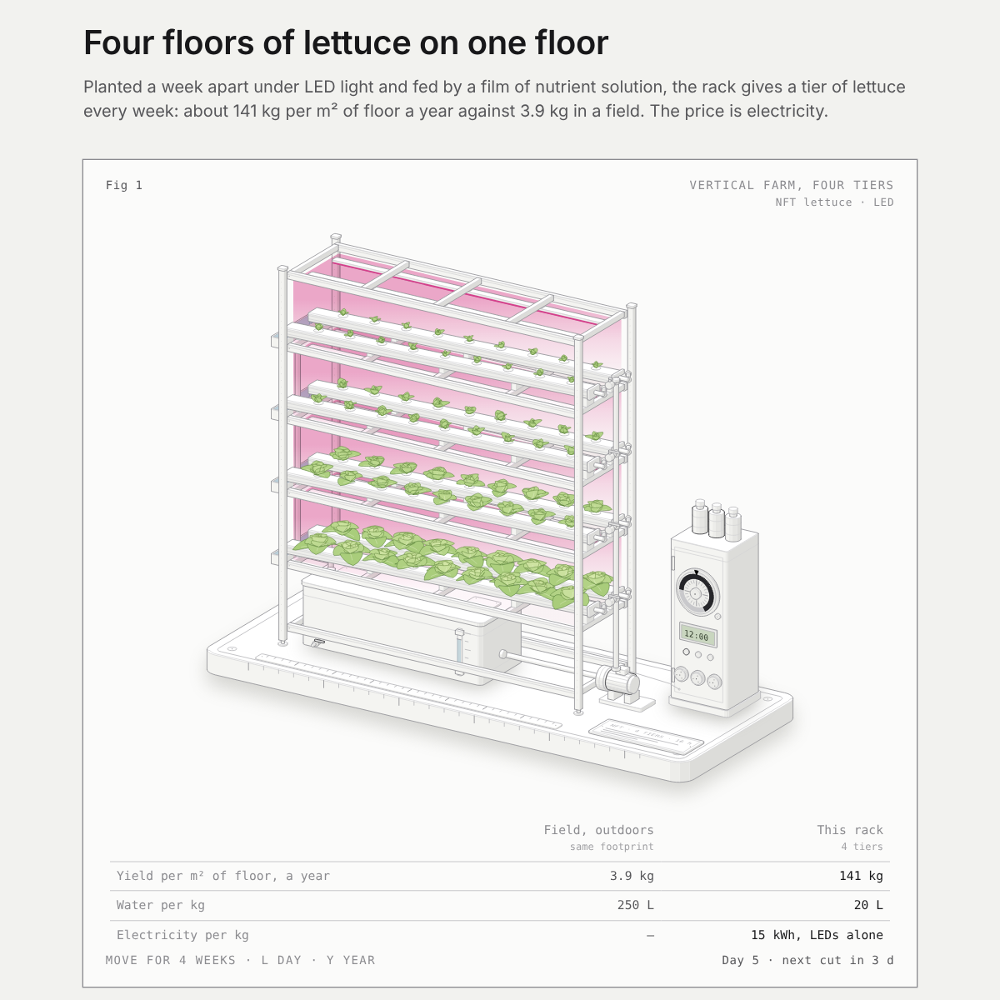

# Vertical farm, four tiers

An interactive figure of a vertical farm: a four-tier rack of hydroponic lettuce under LED bars, compared with field lettuce on the same footprint. It is a separate figure from MR219, built the same way.

**Open it:** https://jamesbarker185.github.io/mr219-rice/vertical-farm/

A model rack drawn to scale (1 unit = 1 cm). Each tier holds two NFT gullies of nine butterhead lettuces under red and blue LED bars. A pump lifts nutrient solution from the tank under the rack up a riser to every gully. The solution runs down a 1 in 40 fall and drains back from gutters at the far end. Beside the rack is a cabinet with a 24-hour segment timer, an EC and pH display, and dosing pumps.

- **Move the pointer across** to run four weeks. The tiers were planted a week apart, so one tier is cut and replanted every week.
- **Click, or press L**, to run one day on the timer. The lights switch off at 22:00 and on at 06:00, and the daily light integral adds up to 14.4 mol/m².
- **Press Y** to run a year: 52 tier harvests, about 141 kg per m² of floor.

The numbers:

- 72 heads on 1.2 m², 28 days on the rack after 14 days as a seedling, about 180 g each.
- Light is 250 µmol/m²/s for 16 h a day. At 2.7 µmol/J that is about 1.5 kWh per m² of tier a day, or about 15 kWh per kg of lettuce for the LEDs alone, before cooling.
- Field and hydroponic yield and water use (3.9 kg/m²/yr and 250 L/kg in a field, 20 L/kg hydroponic) are from Barbosa et al. (2015), "Comparison of land, water, and energy requirements of lettuce grown using hydroponic vs. conventional agricultural methods".
- Head growth and mass are illustrative.

## Files

- `index.html`: the figure, one self-contained page that needs no other files.
- `preview.png`: the 1200 × 1200 image for social posts.
- `source/`: the build script, live code, model and styles. They are built with the [Anatomy](https://github.com/wheresryan22/anatomy) figure kit. To rebuild, put the folder two levels below the kit's root (for example `anatomy/work/vertical-farm/`) and run `node build.mjs`, or `node build.mjs --dark` for the dark theme.

## Credits

The page includes code from the Anatomy kit, MIT License, Copyright (c) 2026 Ryan.
